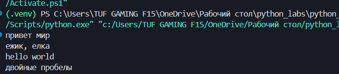
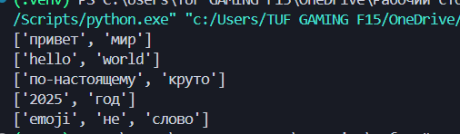
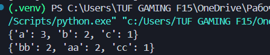
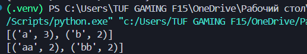
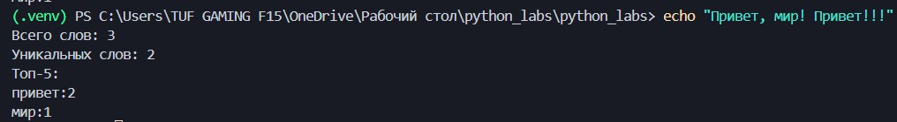

# Лабораторная работа №3

## Тексты и частоты слов

---

## Задание A — text.py

### Функция normalize

Функция приводит текст к нижнему регистру, заменяет букву ё на е, убирает переносы строк и лишние пробелы.
Приводим в зависимости от метода либо к ловер либо к кейсфолд, далее меняем все Ё/ё, убираем переносы строк и собираем

```python
def normalize(text: str, *, casefold: bool = True, yo2e: bool = True) -> str:
    if casefold:
        text = text.casefold()
    else:
        text = text.lower()
    if yo2e:
        text = text.replace('ё', 'е').replace('Ё', 'Е')

    text = text.replace('\t', ' ')
    text = text.replace('\r', ' ')
    text = text.replace('\n', ' ')
    text = ' '.join(text.split())
    return text
```



### Функция tokenize

Разбиваем текст на слова через регулярки и потом через findall ищем слова либо с дефисом с дальнейшим словом либо полные до окончания строки

```python
import re

def tokenize(text: str) -> list[str]:
    return re.findall(r'\w+(?:-\w+)*', text)
```



### Функция count_freq

Функция считает сколько раз встречается каждое слово и возвращает словарь с частотами

```python
def count_freq(tokens: list[str]) -> dict[str, int]:
    freq = {}
    for word in tokens:
        if word in freq:
            freq[word] += 1
        else:
            freq[word] = 1
    return freq
```



### Функция top_n

Функция возвращает список самых частых слов, сначала сортирует по убыванию количества, а при равенстве по алфавиту

```python
def top_n(freq: dict[str, int], n: int = 5) -> list[tuple[str, int]]:
    items = list(freq.items())
    items.sort(key=lambda x: (-x[1], x[0]))
    return items[:n]
```



---

## Задание B — text_stats.py

Сначала считали stdin и еще надо самому перевести кодировку по дефолту винда в utf-16, надо в utf-8, делаем по порядку дальше.

```python
import sys
from src.lib.text import normalize, tokenize, count_freq, top_n

text = sys.stdin.readline()
text = normalize(text)
tokens = tokenize(text)
freq = count_freq(tokens)
top = top_n(freq, 5)

print(f"Всего слов: {len(tokens)}")
print(f"Уникальных слов: {len(freq)}")
print("Топ-5:")
for w, c in top:
    print(f"{w}:{c}")
```


'''
