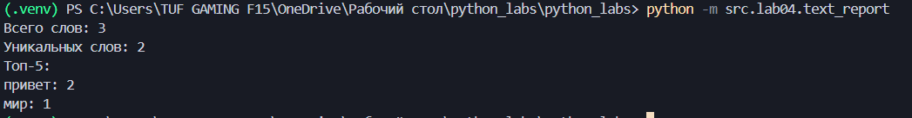
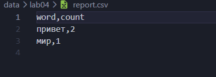
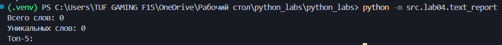
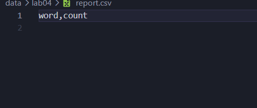
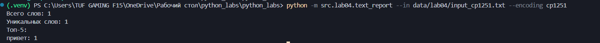
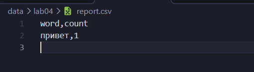
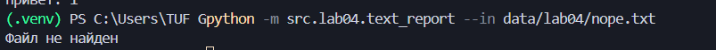

# ЛР04

# Задание А

## 1. read_text

```python
def read_text(path: str | Path, encoding: str = "utf-8") -> str:
    """
    Читает текстовый файл и возвращает его содержимое одной строкой.

    По умолчанию используется UTF-8.
    Для другой кодировки можно указать encoding="cp1251".

    Если файл не найден, возникает FileNotFoundError.
    Если файл нельзя декодировать, возникает UnicodeDecodeError.
    """
    p = Path(path)
    return p.read_text(encoding=encoding)
```

Функция читает текст из файла и возвращает его строкой. Для работы с путём использовал `Path`. Кодировку можно указать отдельно, по умолчанию стоит UTF-8.

Пример запуска:





## 2. write_csv

```python
def write_csv(rows: list[tuple | list], path: str | Path, header: tuple[str, ...] | None = None) -> None:
    """
    Записывает данные в csv
    rows - список строк, которые нужно записать
    path - путь к файлу
    header - заголовок CSV, если он нужен
    Все строки должны быть одинаковой длины. Если длина отличается, возникает ValueError. Файл сохраняется в кодировке UTF-8.
    """
    if rows:
        stolb = len(rows[0])
        for row in rows:
            if len(row) != stolb:
                raise ValueError('Все строки должны иметь одинаковую длину')
    p = Path(path)
    with p.open('w', newline='', encoding='utf-8') as f:
        wr = csv.writer(f)
        if header is not None:
            wr.writerow(header)
        for r in rows:
            wr.writerow(r)
```

Функция записывает данные в CSV. Сначала проверяет, чтобы все строки были одинаковой длины. Если это не так, выдаёт `ValueError`.

Дальше открывает файл и записывает строки через `csv.writer`. Если передан заголовок, он записывается первым. Сам файл сохраняется в UTF-8.

Пример запуска:




# Задание B

```python
import argparse
import sys
from src.lib.text import normalize, tokenize, count_freq, top_n
from src.lab04.io_txt_csv import read_text, write_csv

def freq_txt(text: str) -> dict[str, int]:
    tokens = tokenize(normalize(text))
    return count_freq(tokens)

def sorted_word_counts(freq: dict[str, int]) -> list[tuple[str, int]]:
    return sorted(freq.items(), key=lambda x: (-x[1], x[0]))

parser = argparse.ArgumentParser()
parser.add_argument("--in",dest="input_path",default="data/lab04/input.txt")
parser.add_argument("--out",dest="output_path",default="data/lab04/report.csv")
parser.add_argument("--encoding", default="utf-8")
argums = parser.parse_args()

try:
    txt = read_text(argums.input_path, encoding=argums.encoding)
except FileNotFoundError:
    print("Файл не найден")
    sys.exit(1)

freq = freq_txt(txt)
rows = sorted_word_counts(freq)
write_csv(rows, argums.output_path, header=('word', 'count'))

print("Всего слов:", sum(freq.values()))
print("Уникальных слов:", len(freq))
print("Топ-5:")
for word, count in top_n(freq, 5):
    print(f"{word}: {count}")
```

Для этого задания использовал функции из третьей лабы: `normalize`, `tokenize`, `count_freq` и `top_n`.

Написал две небольшие функции. `freq_txt` нормализует текст, разбивает его на слова и считает, сколько раз встречается каждое слово.

`sorted_word_counts` сортирует слова по количеству повторений от большего к меньшему. Если количество одинаковое, сортировка идёт по алфавиту.

Для аргументов командной строки использовал `argparse`. Через него можно указать входной файл, выходной CSV и кодировку.

Аргументы:

- `--in` — входной файл, по умолчанию `data/lab04/input.txt`.
- `--out` — выходной CSV, по умолчанию `data/lab04/report.csv`.
- `--encoding` — кодировка, по умолчанию `utf-8`.

После запуска программа выводит общее количество слов, количество уникальных слов и топ-5 самых частых слов. Также создаётся CSV с колонками `word,count`.

## Примеры запуска

### Кодировка cp1251





### Файл не найден


