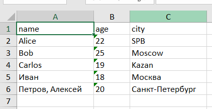

# ЛР5 - JSON и конвертации (JSON↔CSV, CSV→XLSX)

## Задание А. JSON ↔ CSV

### Код

```python
import json
import csv
from pathlib import Path
def json_to_csv(json_path: str, csv_path: str) -> None:
    p = Path(json_path)
    with p.open('r', encoding='utf-8') as f:
        data = json.load(f)
    if not data or not isinstance(data,list):
        raise ValueError('пустой json или неверный')
    if not all(isinstance(row,dict) for row in data):
        raise ValueError('нет списка')
    keys = set()
    for row in data:
        for key in row:
            keys.add(key)
    fieldnames = sorted(keys)
    out = Path(csv_path)
    with out.open("w", newline="", encoding="utf-8") as f:
        writer = csv.DictWriter(f, fieldnames=fieldnames, restval="")
        writer.writeheader()
        writer.writerows(data)
```

### Функция json_to_csv

Функция переводит json в csv.

Сначала через Path открывается json, а json.load считывает данные. Затем проверяется, что это непустой список словарей, иначе вызывается ValueError.

Дальше через set собираются все ключи из словарей без повторений, а sorted сортирует их по алфавиту. Это нужно, потому что в разных словарях могут быть разные ключи.

После этого csv.DictWriter создаёт csv с нужными столбцами. writeheader записывает заголовки, writerows записывает все строки, а restval="" оставляет пустые поля, если какого-то ключа нет.

#### Проверка json_to_csv

**Вход (JSON):**

```json
[
  {"name": "Alice", "age": 22},
  {"name": "Bob", "city": "Moscow"},
  {"name": "Carlos", "age": 19, "city": "Kazan"}
]
```

**Выход (CSV):**

```csv
age,city,name
22,,Alice
,Moscow,Bob
19,Kazan,Carlos
```

Все ключи попали в заголовки, а там, где значений не было, остались пустые поля.

### Функция csv_to_json

```python
def csv_to_json(csv_path: str, json_path: str) -> None:
    p = Path(csv_path)

    with p.open('r', newline='', encoding='utf-8') as f:
        read = csv.DictReader(f)
        rows = list(read)
        if not read.fieldnames or not rows:
            raise ValueError('csv пустой или нет заголовка')
    out = Path(json_path)
    with out.open('w', encoding='utf-8') as f:
        json.dump(rows, f, ensure_ascii=False, indent=2)
if __name__ == '__main__':
    json_to_csv('data/lab05/samples/people.json', 'data/lab05/out/people_from_json.csv')
    csv_to_json("data/lab05/samples/people.csv","data/lab05/out/people_from_csv.json")
```

Функция переводит csv в json.

Сначала открывается csv, а csv.DictReader считывает строки как словари. list собирает их в один список.

Затем проверяется, что есть заголовки и строки. Если данных нет, вызывается ValueError.

После этого json.dump записывает данные в json. ensure_ascii=False нужен, чтобы русский текст нормально отображался, а indent=2 делает отступы для удобства чтения.

При чтении csv все значения становятся строками, поэтому числа в json тоже будут в кавычках.

#### Проверка csv_to_json

**Вход (CSV):**

```csv
name,age,city
Alice,22,SPB
Bob,25,Moscow
Carlos,19,Kazan
Иван,18,Москва
"Петров, Алексей",20,Санкт-Петербург
```

**Выход (JSON):**

```json
[
  {
    "name": "Alice",
    "age": "22",
    "city": "SPB"
  },
  {
    "name": "Bob",
    "age": "25",
    "city": "Moscow"
  },
  {
    "name": "Carlos",
    "age": "19",
    "city": "Kazan"
  },
  {
    "name": "Иван",
    "age": "18",
    "city": "Москва"
  },
  {
    "name": "Петров, Алексей",
    "age": "20",
    "city": "Санкт-Петербург"
  }
]
```

Заголовки csv стали ключами в json, все значения записались строками. Русский текст и запятая внутри имени сохранились.

---

## Задание Б. CSV → XLSX

### Код

```python
import csv
from pathlib import Path
from openpyxl import Workbook


def csv_to_xlsx(csv_path: str, xlsx_path: str) -> None:
    p = Path(csv_path)
    with p.open("r", newline="", encoding="utf-8") as f:
        reader = csv.reader(f)
        rows = list(reader)

    if not rows:
        raise ValueError("CSV файл пустой")

    wb = Workbook()
    ws = wb.active
    ws.title = "Sheet1"

    for row in rows:
        ws.append(row)

    for col in ws.columns:
        max_len = 0
        for cell in col:
            if cell.value is not None:
                length = len(str(cell.value))
                if length > max_len:
                    max_len = length
        letter = col[0].column_letter
        ws.column_dimensions[letter].width = max(max_len + 2, 8)

    wb.save(xlsx_path)


if __name__ == "__main__":
    csv_to_xlsx("data/lab05/samples/test_b.csv", "data/lab05/out/test_b.xlsx")
```

### Функция csv_to_xlsx

Функция переводит csv в Excel.

Сначала csv.reader считывает csv, а list сохраняет все строки в список. Если csv пустой, вызывается ValueError.

Затем Workbook создаёт новую книгу Excel, wb.active выбирает лист, а ws.title задаёт ему название Sheet1.

Далее ws.append добавляет строки из csv в Excel.

После этого через ws.columns перебираются столбцы. С помощью len и str находится максимальная длина значения в каждом столбце. column_letter определяет букву столбца, а column_dimensions.width устанавливает ширину с запасом в 2 символа, но минимум 8.

В конце wb.save сохраняет Excel.

#### Проверка csv_to_xlsx

**Вход (CSV):**

```csv
name,age,city
Alice,22,SPB
Bob,25,Moscow
Carlos,19,Kazan
Иван,18,Москва
"Петров, Алексей",20,Санкт-Петербург
```

**Выход (XLSX):**


